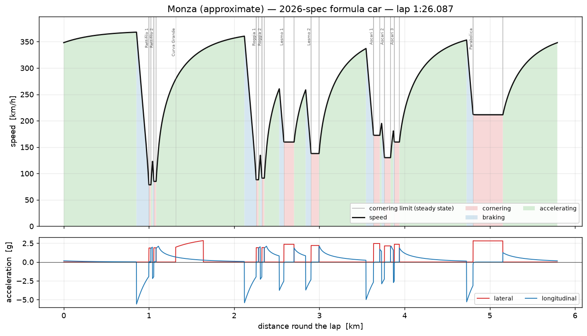
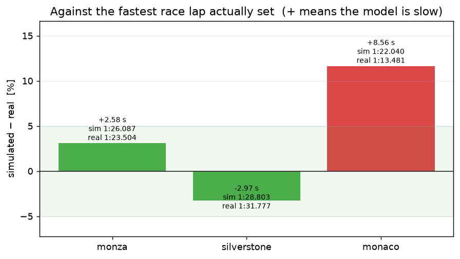
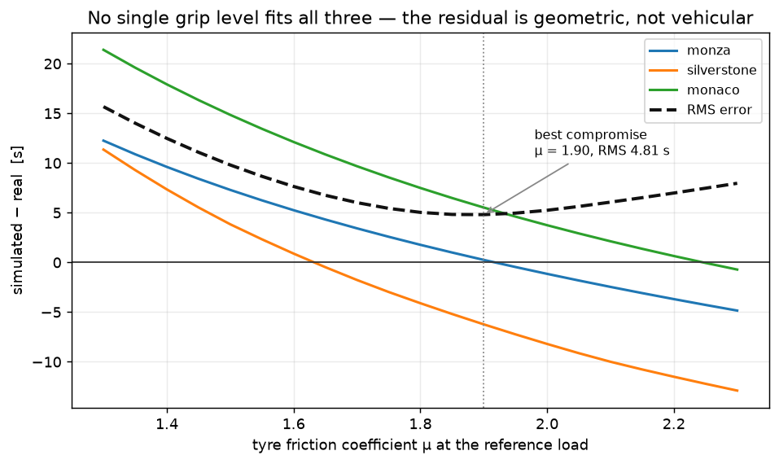
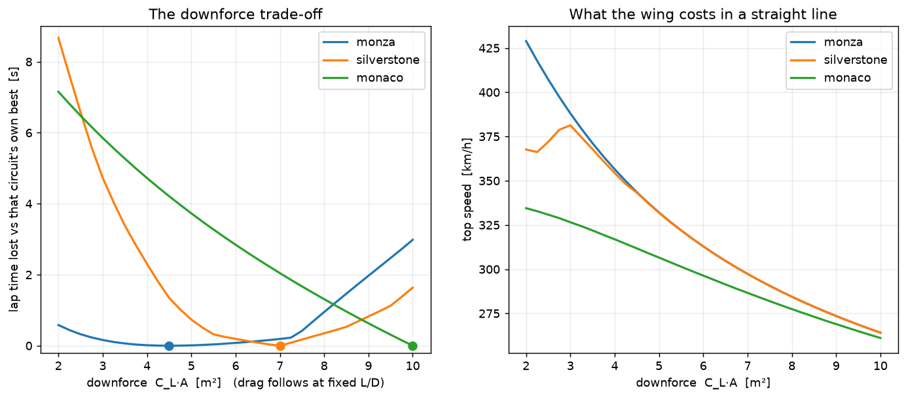
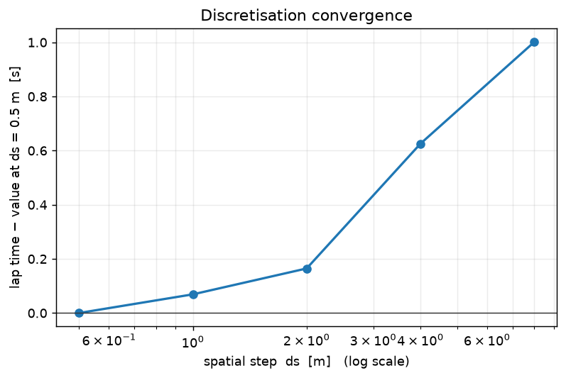
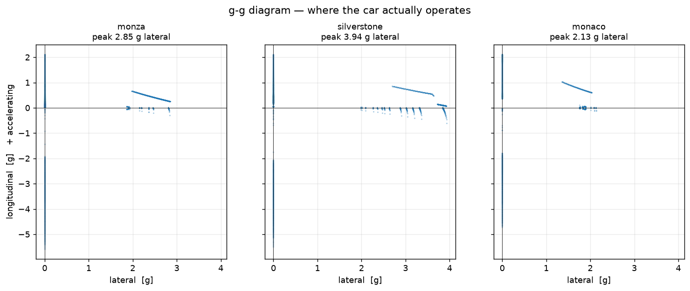

# Lap Time Simulation

A **quasi-steady-state lap time simulation** of a 2026-regulation Formula car,
checked against the lap times actually set in the 2026 season — and honest
about where it disagrees.

```bash
pip install -r requirements.txt
python run.py                      # three circuits, validation, studies (~3 min)
python run.py --quick              # smoke test
python tests/test_laptime.py       # 25 checks against closed-form physics
```

No optimiser, no driver model, no library. The solver is about sixty lines,
and the reason to write it rather than call one is that every assumption
stays visible.

---

## The method, in three passes

A quasi-steady-state solver rests on one assumption: at every point of the
lap the car is on the limit of *something*. The tyres are saturated sideways,
or lengthways, or the engine has run out of power. The driver is never in the
middle of the envelope.

That turns the lap into a construction rather than a search:

1. **The limit speed** at every point, from the curvature and the grip
   available at that speed — which depends on the speed, because downforce
   does, so it is a root find rather than a formula.
2. **A braking pass, walked backwards.** No point may be faster than the
   speed from which the car could still make the next limit.
3. **An acceleration pass, walked forwards.** No point may be faster than the
   speed the car could have reached from the one before.

Take the lowest of the three and the lap is determined. On a closed circuit
the passes wrap around and repeat until the lap stops changing — the exit of
the last corner sets the speed onto the start line. All three circuits here
settle in **3 passes**.



Red is tyre-limited cornering, blue braking, green accelerating. Monza spends
**23.5%** of the lap at the cornering limit, **13.8%** braking and **62.7%**
with the engine as the limit.

## Result

| circuit | simulated | fastest race lap, 2026 | error |
|---|---|---|---|
| Monza | 1:26.087 | **1:23.504** (Antonelli) | **+2.58 s, +3.1%** |
| Silverstone | 1:28.803 | **1:31.777** (Antonelli) | **−2.97 s, −3.2%** |
| Monaco | 1:22.040 | **1:13.481** (Antonelli) | **+8.56 s, +11.6%** |



Real lap times are pulled live from the public Jolpica API, the open
continuation of Ergast, and cached in the repo so every number above is
reproducible.

Two circuits land inside ±3.2% from physics alone, with nothing fitted. The
third misses by 11.6%, and the interesting question is *which part of the
model is wrong*.

## Which part is wrong — asked properly

The temptation is to turn up the grip until the answer is right. So do it
deliberately, and watch what happens:



Each circuit, on its own, implies a different tyre:

| circuit | grip coefficient μ needed to match reality |
|---|---|
| Silverstone | **1.632** |
| Monza | **1.918** |
| Monaco | **2.246** |

A spread of **0.61 in μ**, nearly 40%. The best single compromise is μ = 1.90
at an RMS error of **4.81 s**, and at that value Silverstone is 6.23 s
optimistic while Monaco is 5.52 s pessimistic. **The residuals straddle zero,
so no tyre reconciles them** — and that is the answer: the error is not in the
car model, it is in the three hand-estimated track files. A vehicle parameter
is global and the error is not.

This is the test worth copying. A model that can be tuned to match one data
point tells you nothing; a model confronted with three at once tells you where
it is broken. `test_no_single_grip_level_fits_every_circuit` asserts exactly
this, including that the residuals must straddle zero.

Knowing the sign of each error says which way each track file is wrong:
Silverstone's corner radii are too generous, so the car carries too much
speed; Monaco's layout has too much straight between corners that in reality
flow into one another.

## The downforce trade-off

Adding wing buys cornering speed and costs straight-line speed, so there is an
optimum — and it should be different at every circuit. That is why teams bring
different aerodynamic packages to Monza and Monaco, and it falls straight out:



Downforce is swept at **fixed aerodynamic efficiency**, so drag rises with it.
Letting downforce grow without a drag penalty would make the question
meaningless.

| circuit | optimum C<sub>L</sub>A | within 0.1 s of best | top speed there |
|---|---|---|---|
| Monza | **4.50** | 3.50 – 6.00 | 343.5 km/h |
| Silverstone | **7.00** | 6.50 – 7.25 | 297.3 km/h |
| Monaco | **10.00** (never turns over) | — | 261.1 km/h |

Three different answers, and three different *shapes* of answer:

- **Monza barely cares.** Anything from C<sub>L</sub>A 3.5 to 6.0 is within a
  tenth. Running 2.0 costs 0.58 s; the wing is nearly free to choose, and the
  reason is that Monza's few corners are fast enough to be taken on aero grip
  the car already has.
- **Silverstone has a real optimum** and punishes both sides of it: 8.67 s
  across the range tested, with a sharp floor around 7.0.
- **Monaco never turns over.** More wing is still winning at the end of the
  range, which is the honest model answer and the real-world one — at Monaco
  you run the maximum downforce you can build.

### The asymmetry is the useful part

Run each circuit's own optimum at all three:

| setup | at Monza | at Silverstone | at Monaco |
|---|---|---|---|
| **Monza** (4.50) | 1:26.037 | 1:27.001 **+1.35** | 1:21.094 **+4.21** |
| **Silverstone** (7.00) | 1:26.227 **+0.19** | 1:25.652 | 1:18.927 **+2.04** |
| **Monaco** (10.00) | 1:29.021 **+2.98** | 1:27.290 **+1.64** | 1:16.882 |

Taking the **Silverstone** wing to Monza costs **0.19 s**. Taking the
**Monza** wing to Silverstone costs **1.35 s** — seven times as much. The
penalty is strongly asymmetric: *too little wing is far more expensive than
too much*, because the lap time lost in every corner is paid repeatedly while
the straight-line loss is paid once. The exception is the extreme — the Monaco
package at Monza costs 2.98 s, because a 264 km/h top speed on a circuit with
4.2 km of straight cannot be recovered anywhere.

## Sensitivities

What the model is really for. Central differences, in the units a race
engineer quotes, at Monza:

| change | lap time | of a lap |
|---|---|---|
| +10 kg mass | **+0.275 s** | +0.32% |
| +10 kW power | **−0.190 s** | −0.22% |
| +0.1 tyre grip | **−1.657 s** | −1.92% |
| +0.1 m² drag area | **+0.644 s** | +0.75% |
| +0.5 m² downforce area | **−1.001 s** | −1.16% |

Grip dominates everything. A tenth of a friction coefficient is worth more
than 60 kg of mass or 85 kW of power — which is why the sport spends what it
does on tyre understanding, and why the calibration study above matters: the
one parameter the lap is most sensitive to is the one nobody publishes.

## Four things that were wrong before they were right

### 1. A gearing cap made drag free, and the trade-off vanished

The first run put the optimum at the top of the sweep for **all three**
circuits — more wing always won, even at Monza, which is the opposite of
reality.

The cause was a top-speed ceiling set at 349 km/h to stand in for gearing. It
was binding on every straight, so added drag cost nothing: the car hit the same
ceiling either way and kept the extra cornering grip for free. A constraint
meant to add realism had quietly deleted the entire question. The ceiling is
now set far above anything reachable and **top speed is set by drag**, where
it belongs.

### 2. Tyre load sensitivity decides the whole answer

Even with drag restored, the optimum stayed at the end of the range. The
missing physics was tyre **load sensitivity** — real tyres lose friction as
they are pressed harder, so downforce has diminishing returns, and a car
generating several times its own weight in download is working its tyres far
from where μ was quoted.

Sweeping the exponent at Monza:

| exponent k | optimum C<sub>L</sub>A | within 0.1 s of best |
|---|---|---|
| 0.15 | 6.00 | 6.00 only |
| **0.25** | **4.50** | 3.50 – 6.25 |
| 0.35 | 3.00 | 2.50 – 3.75 |

Doubling the exponent halves the optimum wing level, and the width of the
optimum moves with it too.

**The optimum wing level is set almost entirely by a tyre parameter, not by an
aerodynamic one.** The model now uses k = 0.25, and that choice is the single
largest soft assumption in the repo — which is exactly why it is in the car
file rather than in the source.

### 3. The classifier called the Parabolica a straight

The speed trace shaded the Parabolica "flat out" while the acceleration trace
underneath showed it pulling 2.6 g. The classifier tested
`speed >= limit - 1e-6`, and through a long corner the solver holds the car a
hair *under* its steady-state limit while shedding the last of the entry
speed, so the test failed and the point fell through to the default.

It now classifies by which constraint binds — lateral use above 98% of the
friction circle — and Monza's cornering share went from a nonsensical **0.9%
to 23.5%**.

The same fix exposed a second mislabel: "full throttle" had been defined as
*accelerating*, which misses corners taken at full throttle and counts
steady-speed corners where the driver is balancing drag on part throttle. It
is now defined as the engine, rather than the tyre, being the binding
constraint.

### 4. A test that was really testing brentq

`test_the_friction_ellipse_leaves_nothing_at_the_lateral_limit` asserted that
a car at the cornering limit has no acceleration left. It failed — by
1.4 × 10⁻⁵ m/s².

The longitudinal budget is `sqrt(total² − lateral²)`, and at the limit those
two are equal, so the square root has **infinite slope** there. The root find
lands within 6 × 10⁻⁹ N of the limit and that still leaves 1.1 × 10⁻² N of
apparent longitudinal force — six orders of magnitude of amplification. The
physics was right and the tolerance was the wrong shape: the assertion is now
written as a fraction of the friction circle, where the leftover is one part
in ten million.

## Numerics



| step ds | lap time | vs finest |
|---|---|---|
| 8.0 m | 87.0197 s | +1.0015 |
| 4.0 m | 86.6439 s | +0.6257 |
| 2.0 m | 86.1829 s | +0.1646 |
| 1.0 m | 86.0872 s | +0.0689 |
| 0.5 m | 86.0183 s | — |

Convergence is monotone but **not clean**: the gaps between successive
refinements are 0.376, 0.461, 0.096, 0.069 — the second is larger than the
first. A coarse grid places each braking point to within half a step, and that
error is not a smooth function of the step size. The resolved track length is
identical at every step, so this is the solver, not the geometry.

The production step is 1 m, which sits 0.069 s from the 0.5 m answer — an
order of magnitude below the model's disagreement with reality, which is the
only justification a step size needs.



The g-g diagram is the model auditing itself. Points on the envelope are
tyre-limited; points inside it are limited by something else — power, or
simply the end of a straight arriving.

## Layout

| File | Role |
|---|---|
| `src/vehicle.py` | Point-mass car: aero, load-sensitive tyre, friction ellipse. |
| `src/track.py` | Segment list → curvature against distance, plus closure checks. |
| `src/solver.py` | The three passes, and the regime classifier. |
| `src/sweeps.py` | Downforce trade, sensitivities, the grip calibration test. |
| `src/validate.py` | Real lap times from the Jolpica API, cached. |
| `src/charts.py`, `src/report.py` | Six figures and a printable PDF report. |
| `src/paper.py` | Page composition: A4 pages, tables, figure bands. |
| `tools/fit_tracks.py` | Makes the hand-drawn circuits close and match official length. |
| `data/tracks/*.json` | Three circuits as straights and arcs. |

Circuit geometry is reproducible rather than hand-tweaked: `fit_tracks.py`
applies named angle corrections so each lap sums to exactly 360°, then scales
every straight by one common factor until the lap matches its published
length. Corner radii are never touched, because they set the cornering speeds
the whole simulation turns on.

## Testing

```
25/25 passed
```

Closed-form physics, not stored output:

- a skidpad returns **v = √(μgR)** exactly, and the full solver returns
  circumference ÷ that speed
- the winged corner matches its algebraic solution, **v² = μmg / (mκ − ½μρC<sub>L</sub>A)**
- below a critical curvature a winged car has **no lateral speed limit at
  all** — the denominator above goes to zero and the corner is flat
- braking distance is **v²/(2μg)** to within 0.2%, integrated step by step
- top speed is where **P·η = ½ρC<sub>D</sub>Av³ + C<sub>rr</sub>mgv**, solved
  independently with a root find
- doubling tyre load must **not** double grip
- every circuit closes to 360° and matches its official length to under a metre
- a closed lap needs **more than one pass** — the wrap-around is asserted, not
  assumed
- refining the step moves the answer **monotonically** toward its limit, and
  the track length does not change while it does
- mass, power, grip and drag all move lap time the **right way**
- Monaco wants **more wing than Monza** — the study's whole conclusion, as a test
- **no single grip value fits all three circuits**, and the residuals straddle zero

## Fachbegriffe

| English | Deutsch |
|---|---|
| Lap time simulation | Rundenzeitsimulation |
| Vehicle dynamics | Fahrdynamik |
| Downforce | Abtrieb |
| Drag | Luftwiderstand |
| Aerodynamic efficiency (L/D) | Aerodynamische Güte |
| Curvature / radius | Krümmung / Radius |
| Friction ellipse / Kamm's circle | Reibungsellipse / Kammscher Kreis |
| Tyre load sensitivity | Radlastabhängigkeit des Reibbeiwerts |
| Coefficient of friction | Reibbeiwert |
| Cornering speed | Kurvengeschwindigkeit |
| Steady state | Stationärer Zustand |
| Sensitivity analysis | Sensitivitätsanalyse |
| Validation / model calibration | Validierung / Modellabgleich |
| Discretisation / step size | Diskretisierung / Schrittweite |
| Convergence study | Konvergenzuntersuchung |

## Scope

The physics is real: a load-sensitive tyre, speed-dependent downforce, a
friction ellipse, a proper root find for cornering speed, and a solver that
converges. The validation is real, against lap times actually set.

**The circuits are not surveyed.** Every corner is a constant-radius arc, and
the radii and straight lengths are estimated from published layouts. This is
the dominant error, it is why Monaco is 11.6% out, and the calibration study
above is the evidence rather than an excuse. The drawn centre lines do not
close — by 943 m at Monza — but only κ(s) reaches the solver, so that affects
no lap time.

Not modelled: weight transfer and individual wheel loads; suspension and tyre
transients; the racing line, which is chosen by the driver and here is simply
the centre line; gear ratios and shift losses; the **finite ERS energy budget**,
so full hybrid deployment is assumed everywhere and the car is faster than a
real one on long straights; **2026 active aerodynamics**, where straight and
corner modes would change C<sub>L</sub>A and C<sub>D</sub>A round the lap — the
bounding cases are in the downforce sweep, but the switching is not; tyre
degradation, fuel burn, wind, track temperature and elevation.

It is a **lower bound on the car, not a prediction of the driver**. The
comparison is against the fastest *race* lap, set on a heavy car in traffic,
so a clean-lap simulation should sit a little under it. Two of the three do.

---

Built by [Prathamesh Bedre](https://github.com/Pratsss24) — M.Sc. Intelligent
Manufacturing, TU Clausthal. Companion repos:
[cmm-spc-dashboard](https://github.com/Pratsss24/cmm-spc-dashboard),
[tolerance-stackup](https://github.com/Pratsss24/tolerance-stackup),
[opcua-machine-monitor](https://github.com/Pratsss24/opcua-machine-monitor),
[production-line-sim](https://github.com/Pratsss24/production-line-sim) and
[scan-cad-deviation](https://github.com/Pratsss24/scan-cad-deviation).
